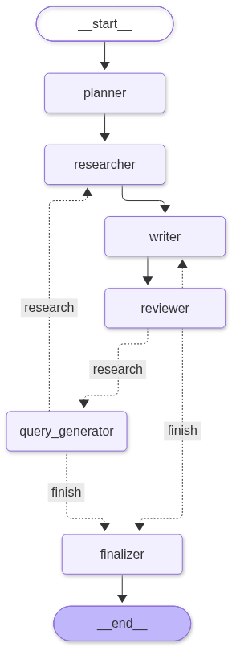

# AI Research Assistant

AI Research Assistant is a FastAPI service that researches a topic on the web and produces a cited report in Markdown and PDF formats. It uses Gemini to plan and write the report, Tavily to find sources, and LangGraph to coordinate the workflow.

## What it does

For each research request, the service:

1. Asks Gemini to break the topic into research questions.
2. Searches the web for each question with Tavily and removes duplicate URLs.
3. Asks Gemini to write a report grounded in the collected search snippets.
4. Has a Gemini reviewer assess completeness, readability, and citation grounding. The writer can receive one revision based on the review.
5. Saves the report as Markdown, adds a references list from the collected sources, and exports a PDF.

The workflow also contains code for generating follow-up research queries, though the current review routing does not send findings to the researcher.

## Requirements

- Python 3.12 or later
- A Gemini API key
- A Tavily API key

The planner and reviewer use `GEMINI_MODEL_STRONG`. Set it to a model available to your Gemini API key; unlike `GEMINI_MODEL`, the application does not provide a default for this setting.

## Setup

Clone the repository and change into its directory. Create and activate a virtual environment, then install the pinned dependencies:

```bash
python -m venv .venv
source .venv/bin/activate
pip install -r requirements.txt
```

On Windows PowerShell, activate the environment with `.venv\Scripts\Activate.ps1`.

Create a local `.env` file from the example and enter your API keys and reviewer model:

```bash
cp .env.example .env
```

Configure the values in `.env`:

```dotenv
GEMINI_API_KEY=your_gemini_api_key
GEMINI_MODEL=gemini-2.5-flash
GEMINI_MODEL_STRONG=your_reviewer_model
TAVILY_API_KEY=your_tavily_api_key
```

`GEMINI_MODEL` defaults to `gemini-2.5-flash` if omitted. Both API keys are required, and `GEMINI_MODEL_STRONG` must be set for planner and reviewer calls. Keep `.env` private; it is excluded from the Docker build context and should not be committed.

## Run locally

Start the API from the repository root:

```bash
uvicorn app.main:app --reload
```

The service listens at [http://localhost:8000](http://localhost:8000). Interactive API documentation is available at [http://localhost:8000/docs](http://localhost:8000/docs).

## Run with Docker Compose

After creating `.env` as described above, build and start the service:

```bash
docker compose up --build
```

Compose publishes port `8000` and mounts the host `reports/` directory so generated reports persist on the host. Stop the service with `Ctrl+C`; to stop and remove its container, run `docker compose down`.

## API

### `GET /`

Health check:

```json
{"message": "AI Research Assistant is running"}
```

### `POST /research`

Submit a topic as JSON. The topic must contain 5–300 characters.

```json
{
  "topic": "The impact of climate change on global agriculture"
}
```

The response includes the generated plan, source metadata, report text, review, workflow status, revision counts, and download URLs. For example, the report links appear as:

```json
{
  "report_urls": {
    "markdown": "/reports/the-impact-of-climate-change-on-global-agriculture-1234abcd.md",
    "pdf": "/reports/the-impact-of-climate-change-on-global-agriculture-1234abcd.pdf"
  }
}
```

The filename is generated for each request and will differ. Workflow errors are returned as HTTP `502` responses.

### `GET /reports`

List available Markdown and PDF report filenames:

```json
{"files": ["report-name.md", "report-name.pdf"]}
```

### `GET /reports/{filename}`

Download a generated `.md` or `.pdf` file by filename. Other extensions and path-containing filenames are rejected.

## Project layout

```text
app/
  agents/       Planning, web research, writing, reviewing, and query generation
  schemas/      Request and reviewer response validation
  services/     Gemini, Tavily, source deduplication, and report export helpers
  workflows/    LangGraph state, nodes, routing, and workflow construction
  main.py       FastAPI application and HTTP endpoints
reports/        Generated reports (created when the first report is saved)
```

`workflow_graph.png` is a rendered diagram of the LangGraph workflow. The graph can be regenerated by running `python -m app.workflows.viz`.

## Architecture and workflow

<table>
  <tr>
    <td width="62%" valign="top">
      <p>The diagram shows how a research request moves through the LangGraph workflow:</p>
      <ol>
        <li><strong>Start → Planner:</strong> Gemini turns the topic into focused research questions.</li>
        <li><strong>Planner → Researcher:</strong> Tavily searches each question. Duplicate URLs are removed and sources receive citation IDs such as <code>[S1]</code>.</li>
        <li><strong>Researcher → Writer:</strong> Gemini drafts a Markdown report using the collected source snippets.</li>
        <li><strong>Writer → Reviewer:</strong> The reviewer checks completeness, readability, and citation grounding.</li>
        <li><strong>Review routing:</strong> An approved report goes to the finalizer. Writing feedback returns to the writer. The diagram also shows a research feedback path through the query generator and researcher.</li>
        <li><strong>Finalizer → End:</strong> The service adds references from source metadata, saves the Markdown report, and exports a PDF.</li>
      </ol>
      <p>The workflow allows at most one research revision and one writing revision. Currently, reviewer feedback routes to the writer; the researcher/query-generator route in the diagram is not activated by the review node.</p>
    </td>
    <td width="38%" align="center" valign="top">
      
    </td>
  </tr>
</table>

## Limitations

- **Research uses search snippets, not full source documents.** Tavily returns short content excerpts, and the writer and reviewer receive those snippets rather than fetching and reading the linked pages. This can omit context, qualifications, methods, or newer findings, so reports may be incomplete even when their citations point to relevant pages.
- **Citations are not independently verified against full text.** The reviewer checks citations using the same snippets provided to the writer. It cannot confirm that a claim is supported by the complete linked source.
- **Research breadth is limited.** The planner creates 3–5 questions and the researcher requests up to five results per question. The report therefore reflects a bounded search, not an exhaustive or systematic literature review.
- **Research follow-up is not active.** The graph includes a query generator and research-revision route, but the current reviewer node only selects the writer or finishes. Missing evidence does not trigger another search.
- **A report can finish without approval.** The workflow permits at most one writer revision. If the reviewer still has major findings, the report is finalized with `needs_revision` status rather than blocking delivery.
- **Requests run synchronously.** The `/research` endpoint holds the HTTP request open while search, model calls, review, and PDF generation run. Long jobs can time out at clients or intermediaries, and there is no job status endpoint.
- **Storage is local to the service.** Reports are written to a local `reports/` directory. This works for a single container with a mounted volume, but does not provide shared storage or retention controls for multiple instances.
- **Operational safeguards are minimal.** The API has no authentication, rate limiting, user quotas, or structured application logging. Errors from research are returned as HTTP 502 details, which may expose internal error messages.
- **Output formatting is intentionally basic.** The PDF exporter supports headings, simple bullets, and basic inline bold/italic text; complex Markdown such as tables may not render as expected.

## Future enhancements for production readiness

- **Fetch and extract source pages.** Retrieve linked pages where permitted, extract readable article text, handle JavaScript and paywalls gracefully, and store the retrieved text with source metadata. Keep snippet-only fallback behavior for unavailable pages.
- **Strengthen source quality and citations.** Add domain and publication metadata, source ranking, publication-date checks, cross-source corroboration, and claim-to-passage citation validation. Preserve exact passages used so readers can audit important claims.
- **Complete the research feedback loop.** Route evidence gaps to the query generator and researcher, cap follow-up searches and costs, and expose when a final report remains unapproved.
- **Move long work to background jobs.** Return a job ID from submission, run workflows in a worker queue, and provide job status, progress, cancellation, and result endpoints.
- **Add API protection.** Introduce authentication, rate limits, request size limits, per-user quotas, and safe error responses that avoid returning internal exception details.
- **Use durable shared storage.** Store reports and research artifacts in object storage or a database, add retention/deletion policies, and support multiple API and worker instances.
- **Improve reliability and visibility.** Add structured logs, request/job IDs, metrics, tracing, health/readiness checks, provider retry and timeout policies, and clear handling for provider outages and quota errors.
- **Validate configuration at startup.** Check required API keys and model names with actionable messages; provide separate settings for development and production.
- **Add automated quality gates.** Create unit and integration tests for API validation, graph routing, deduplication, report generation, and error paths; run linting, type checks, and CI before deployment.
- **Harden deployment.** Run as a non-root user, pin and scan dependencies and container images, manage secrets outside `.env`, configure resource limits, and define production deployment and backup procedures.
- **Improve report presentation.** Support richer Markdown in PDF output, include generation time and methodology, and offer report provenance and downloadable source metadata.
